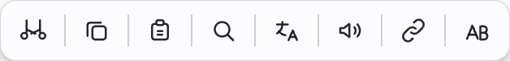
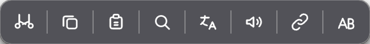

# PopBar

Instant text actions, in the spirit of PopClip, for **macOS and Windows**:
**select text in any app and a small toolbar appears next to it**, ready with the
actions you use most — cut, copy, paste, web search, translate, speak, open the
link, email a snippet, drop it in a new note, change the case, and whatever else
you add through extensions. For everything that is not text there is a
**[drop shelf](#the-drop-shelf)**: shake the pointer while dragging and drop
files, links or snippets onto it until you are ready to move them on.

```
selected text ──▶ selection helper (native, per OS) ──▶ PopBar bar ──▶ action
```





Both pictures are rendered from the app's own bar window — the same markup,
stylesheet and icon set it uses, captured offscreen rather than drawn by hand —
so they cannot drift from what ships. They are always shown at 2× for a crisp line on a
retina display.

**[Download](https://github.com/HybridRCG/PopBar/releases/latest)** ·
**[Project page](web/)** (deployed at `zaaz.co.za/popbar`) ·
**[☕ Buy me a coffee](https://buymeacoffee.com/hybridrcg)**

## Install

| | Download | Then |
|---|---|---|
| **Windows 10/11, 64-bit** | `PopBar-Setup-<version>.exe` | Run it. SmartScreen warns once because the build is not code-signed: *More info → Run anyway*. |
| **macOS 12+, Apple Silicon and Intel** | `PopBar-<version>-universal.dmg` | Open it, drag PopBar to Applications. The build is not notarized: right-click → *Open* the first time. |

Both are attached to the Releases page. The macOS app is a universal binary —
one download runs natively on Apple Silicon and on Intel.

## Updates

Installed copies update themselves from GitHub Releases through
`electron-updater` (that is why a build without `latest.yml` / `latest-mac.yml`
can never update). Ten seconds after launch PopBar checks quietly, downloads a
newer version in the background, and notifies once it is ready. The version line
in the menu turns into the state of that check — *Checking…*, *Downloading… 42%*,
*Restart to Update to 1.0.3* — and clicking it restarts into the new version. An
update that was downloaded also installs when you quit normally. **A check that
fails on its own is a single log line, never a popup**; only a check you started
yourself reports back.

The releases live in a public repository, so an unauthenticated client can fetch
them. On macOS the update is installed by PopBar itself rather than by Squirrel:
before anything is swapped, the download is checked against the signing
requirement the installed app recorded, so a build signed any other way is
refused instead of half-installed. Two limits remain, and both are about signing
rather than the updater:

- **The macOS certificate is PopBar's own, not Apple's.** Builds record the
  requirement `identifier "com.popbar.app"`, which is what lets the Accessibility
  grant survive an update, but no Mac trusts that certificate by default and the
  download is not notarized, so Gatekeeper still wants right-click → *Open* on the
  first launch. An Apple Developer ID is what would remove that.
- **Installs from before the identifier-only signature need one manual
  download.** Those builds recorded a code-hash requirement instead, which no
  later build can satisfy, so their updater refuses the update rather than
  replacing what is running. Download the current version once from Releases;
  updates after that install by themselves.

On first launch macOS asks for **Accessibility** permission: System Settings →
Privacy & Security → Accessibility → switch on **PopBar**. Until that is granted
the bar cannot see selections; the settings window says so. Windows needs no
permission.

The app lives in the menu bar / notification area (the selection-marquee icon) —
there is no Dock or taskbar icon. Settings live under that icon →
*PopBar Settings…* (⌘, on macOS).

## What is in the bar

| Action | What it does |
|---|---|
| Cut / Copy / Paste / Select All | The usual, without leaving the app you are in |
| Search Web | Opens the selection in Google |
| Translate | Opens the selection in Google Translate |
| Speak | Reads the selection — `say` on macOS, SAPI on Windows |
| Open Link | Only shown when the selection is a URL — opens it |
| Email | New message with the text as the body |
| New Note | New Apple Notes note containing the text (macOS only) |
| UPPERCASE / lowercase / Capitalize | Puts the converted text on the clipboard |

Each one can be switched off in Settings; hover a button to see its name.

## The drop shelf

Text is only half of what gets dragged around. The **drop shelf** holds what you
are moving until you are ready to put it somewhere. It opens five ways:

- **Shake the pointer** — start dragging a file, give it a quick shake, and the
  shelf is there to drop into.
- **Hold Shift while dragging** — press Shift partway through a drag of files or
  text and the shelf opens under the pointer.
- **A shortcut** — Control+Alt+S by default; press it again to put the shelf away.
- **Drop files on the menu-bar icon**, or choose *Drop Shelf…* in its menu.
- **Take a screenshot** (macOS) — a new capture lands on the shelf by itself.

What it does with what you drop:

- **Files, folders, links and text** go on the shelf as rows with a large icon:
  a real thumbnail for images, a clear file-type icon for everything else, and
  the size underneath. Several files dropped together become one **stack**;
  click it to open it, right-click it to ungroup.
- **Make a stack yourself:** drag one row onto another (it lights up), or
  right-click a file → *Stack With…* or *Stack All Loose Files*. Right-click a
  file inside a stack → *Take Out of the Stack*.
- **Drag a row back out** into the Finder, Mail or any other app to use it
  there. A whole stack drags out as all of its files at once. *Settings* can
  take a row off the shelf once it has been dragged out.
- **The buttons work on everything at once:** *Move…* sends every file to a
  folder you pick, without overwriting what is already there (a number is added
  instead). *ZIP…* makes one archive. *Reveal* shows the files in the Finder.
  *Copy* puts every path and snippet on the clipboard, and *Paste* adds what the
  clipboard holds.
- **Right-click a row** for that item alone: Open, Quick Look, Reveal in Finder,
  Share (Mail, Messages, AirDrop and the rest of the share sheet), Resize Image,
  Extract Text from an image, Compress to ZIP, Cut, Copy, or Remove.
- **Instant Actions** — drop on a tile instead of on the shelf and it happens
  straight away: *Share*, *Move…*, *ZIP*, *Resize 50%*, *Text* (read the words
  out of an image) and *Copy Path*. The tiles fill the empty shelf and float
  over a full one while you drag.
- **✕ removes a row**, and *Clear shelf* empties it. Something you remove stays
  removed — it does not come back with the next click or drag.
- **Bring a shelf back.** The last ten cleared shelves are kept under *Recent
  Shelves* in the menu-bar menu, and an empty shelf offers *Bring back the last
  shelf*. Whatever was on the shelf when PopBar quit is there too. Files that
  have since been deleted are skipped; stacks come back as stacks.
- **Dropping only collects.** The original file stays where it was until you
  press *Move…*; the shelf starts empty each launch, with the last one a click away.
- **It gets out of the way.** The shelf can hide itself after a while with the
  pointer elsewhere. Hiding never removes anything, and Escape puts it away.

Everything is set under *Settings → Drop shelf*: the shelf itself, its shortcut
(type it or press *Record…*), the shake, and **shake sensitivity** — a slider
from 1, a firm shake, to 10, a small wiggle, with Normal at 5.

This is the one place PopBar borrows from [Dropover](https://dropoverapp.com/)'s
idea of a temporary shelf; the bar itself is still for the selection you have.

## How it decides to appear

A drag-selection shows the bar. A **click** does not, even when the app leaves
text selected behind it (a table cell, a field that already had its text
selected, a triple-click). The helper sees the mouse itself, so it knows the
difference: a press that lets go without moving is a click, and a selection that
appears within two seconds of one is ignored — unless a key was pressed after
the click, because a keyboard selection is always the user's own. Selections are
never read from password fields; the clipboard is untouched in secure input.

Once the bar is up, typing puts it away: the next key you press dismisses it, so
it never sits over text you have gone back to editing. That is the only thing the
helper knows about your keyboard — that a key went down, never which one.

## Extension library

*Settings → Extension library* lists 31 ready-made actions in four groups
(Search, Links, Text, Developer): DuckDuckGo, Bing, YouTube, Amazon, Wikipedia,
GitHub, Stack Overflow, Maps, Spotify, Open in Browser, Shorten Link,
Dictionary, Add to Reminders, Title Case, Sentence case, Join Lines, Sort
Lines, Reverse Lines, Shuffle Lines, Blockquote, Bullet List, Comma List,
URL Encode/Decode, Base64 Encode/Decode, Slugify, ROT13, Word Count,
Format JSON and Strip Formatting.

Tick one to install and switch it on, untick to switch it off, ✕ to remove it
from disk. Each one is written as an ordinary extension folder you can edit in
the PopBar data folder.

**Extensions are shell scripts and run on macOS only.** On Windows they are not
loaded at all (logged once as `extensions-skipped`) rather than appearing as
buttons that fail when clicked.

### Importing a PopClip extension

*Settings → Import PopClip Extension…* accepts a `.popclipext` folder or a
`.popclipextz` / `.zip` file. `Config.json`, `Config.yaml` and `Config.plist`
are all understood. **Shell-script actions are converted**; AppleScript and
JavaScript actions are reported as skipped, since PopBar only runs shell
scripts. `requirements: [url]` becomes `"when": "url"`, `after: copy-result`
becomes `"after": "copy"`, and icons are mapped to the built-in set (or become
the extension's initials).

## Extensions

An extension is a folder in the PopBar data folder under `Extensions/` with a
`Config.json`:

```json
{
  "name": "Search Wikipedia",
  "identifier": "com.popbar.example.wikipedia",
  "version": "1",
  "description": "Open the selected text in Wikipedia",
  "icon": "book",
  "actions": [
    {
      "title": "Wikipedia",
      "shell script": "open \"https://en.wikipedia.org/w/index.php?search=$POPCLIP_URLENCODED_TEXT\""
    }
  ]
}
```

- `shell script` replaces PopClip's `shell script` key: it runs with `/bin/bash`
  (macOS only).
- Placeholders: `{popclip text}`, `{popclip text url-encoded}`, `{popclip app}`,
  `{popclip clipboard}` — shell-quoted for you. The same values arrive as
  `POPCLIP_TEXT`, `POPCLIP_URLENCODED_TEXT`, `POPCLIP_APP_NAME` and
  `POPCLIP_CLIPBOARD`, which is safer for awkward text.
- `"after": "copy"` puts the script's output on the clipboard instead of
  pasting over the selection — handy for transformations.
- `icon` is one of the built-in names (`cut`, `copy`, `paste`, `selectAll`,
  `search`, `translate`, `speak`, `openUrl`, `email`, `note`, `uppercase`,
  `lowercase`, `capitalize`, `puzzle`, `book`, `globe`, `terminal`) or one or
  two characters, e.g. `"🔎"` or `"W"`.
- Several actions in one `Config.json` give one extension several buttons.

Two worked examples ship inside the app; *Settings → Add Example Extensions*
copies them into your extensions folder.

## History

Everything PopBar puts on the clipboard — Copy, Cut, Paste, the case actions,
extension results — is listed under the menu-bar icon → **History** (newest
first, 15 shown, 100 kept). Clicking an entry puts it back on the clipboard.
"Clear History" empties the list. Identical consecutive copies collapse into
one.

## Settings

- **Appearance** — bar height (26–80 px) with a live preview, labels either on
  hover above the icons or permanently under them, and dividers between icons
  (off, extra space, or a hairline). The preview is drawn from the bar's own
  stylesheet and icon set, so it cannot drift from the real bar. A bar that is already on screen adopts the
  new look immediately.
- **Actions** — on/off for every built-in and extension action, and their order:
  drag a row by its ⠿ handle, or use ↑ ↓.
- **Extension library** — 31 ready-made actions to add, switch off or remove.
- **Start at login** — adds PopBar to Login Items.
- **Minimum characters** — ignore very short selections.
- **Never appear in these apps** — name fragments, e.g. `1Password`.
- **Shortcut to bring the bar back** — Control+Alt+P by default. After the bar has
  been dismissed it shows it again for the current selection, or for the last one
  PopBar saw when the app has none left (a click that takes the selection with
  it). *Record…* captures the keys instead of typing them, Escape cancels, an
  empty field turns the shortcut off, and a note says when macOS refuses a
  combination another app owns.
- **Drop shelf** — on or off; its shortcut (Control+Alt+S by default, with the
  same *Record…* button as the bar's shortcut); opening it by a shake, and a
  1–10 slider for how hard that shake has to be; hiding it by itself after a set
  number of seconds; taking a row off once it has been dragged out; opening it
  with Shift while dragging; and showing the Instant Actions tiles.
- **Extensions** — import a PopClip extension, open the folder, reload.
- **Help** — the short version of this README, in the window: when the bar appears
  and what dismisses it, what each button does, your own actions, the history,
  updates, where files live, and what to check when the bar never shows up.
  *PopBar Help…* in the menu opens straight to it.

## Files

| | macOS | Windows |
|---|---|---|
| Settings, extensions, log | `~/Library/Application Support/PopBar/` | `%APPDATA%\PopBar\` |
| Selection helper | the bundled `popbar-ax` helper | the bundled PowerShell helper |

Settings, history and the log are created `0600` and written atomically (temp
file plus rename, with a `.bak` to recover a damaged `config.json`).

## How it works

The helper is a small native program that runs alongside the app and reports
selections as JSON lines on stdout. The Electron process turns each line into
the bar window — a non-activating panel, so clicking a button never takes focus
away from the app you were working in — and runs the chosen action. Actions
that must type into the app (cut, paste, select all) go back through the helper,
which re-activates the source app first and then posts the key event.

| | macOS | Windows |
|---|---|---|
| Helper | a small native program, `popbar-ax` | a PowerShell script |
| Notices a drag | Accessibility event tap | low-level mouse hook (`WH_MOUSE_LL`) |
| Reads the selection | Accessibility (`AXSelectedText`), every 120 ms | UI Automation `TextPattern`, then a Ctrl+C fallback |
| Permission | Accessibility grant | none |
| Password fields | `IsSecureEventInputEnabled()` | UI Automation `IsPassword` |
| Keys (cut/paste/select all) | `CGEvent` | `keybd_event` |

The macOS helper is the only component that needs the Accessibility
permission. The Windows helper needs no compiler or SDK: its small C# pieces are
compiled at start-up with `Add-Type`, using the PowerShell that ships with
Windows. Both speak the same protocol, so the app has a single code path.

## Running from source

The application source is **not published** in this repository, and neither is
anything that builds it. What is here: this README, the project page in `web/`,
and the release downloads and update manifests attached to the releases. The
app source (`src/`), the native selection helpers (`native/`), the build and
release scripts (`scripts/`), the example extensions (`examples/`), the tray and
installer artwork (`build/`) and `package.json` are all outside the repository.
These notes are for a working copy of the app.

```sh
npm install      # also compiles the macOS helper (needs Xcode CLT)
npm start
```

When running from source the Accessibility entry is called **Electron**, not
PopBar.

### Checking it without touching another app

```sh
POPBAR_DEBUG=1 npm start                        # show the bar for a made-up selection at the pointer
POPBAR_DEBUG=1 POPBAR_DEBUG_CLICK=1 npm start   # …and click Copy, printing the clipboard
POPBAR_DEBUG_SETTINGS=1 npm start               # open Settings and print what it rendered
```

`POPBAR_AX_DEBUG=1 native/bin/popbar-ax` prints what the helper sees in the
frontmost app, which is the quickest way to find out why an app does not
produce a bar.

### Building the app (working copy only)

```sh
./scripts/build-app.sh     # macOS: builds, signs with the persistent identity, installs to /Applications
npm run dist:win           # Windows: NSIS installer
npm run dist:mac           # macOS: .dmg and .zip in .build/
```

`npm run dist:mac` builds the Swift helper for **both** architectures, joins the
two with `lipo` into one universal `popbar-ax`, packages an x64 and an arm64 app
and merges them, so the shipped bundle has no Rosetta dependency: both the app
and its helper run natively on either Mac.

All artifacts land in `.build/` (not `dist`), which is git-ignored:

| File | What it is |
|---|---|
| `.build/PopBar-Setup-<version>.exe` | Windows installer (x64, NSIS, one-click, per-user) |
| `.build/PopBar-<version>-universal.dmg` | macOS disk image (Apple Silicon + Intel) |
| `.build/PopBar-<version>-universal.zip` | macOS app as a zip, for tools that prefer it |
| `.build/mac-universal/PopBar.app` | the raw macOS app |

Those names are the release asset names verbatim, which matters: `latest.yml`
and `latest-mac.yml` point at them, and an updater looks for exactly those files.
Every release lists the SHA-256 of each asset in its notes.

The output folder is `.build`, not `dist`, so Spotlight and Launchpad only ever
show the one installed copy — two bundles with the same name are confusing to
pick from and each needs its own Accessibility permission.

`PopBar.app` is menu-bar only (`LSUIElement`), has no Dock icon, and carries
its own copy of the Accessibility helper — no `npm start`, Node or project
folder needed to run it.

### Why a signing identity (macOS)

An ad-hoc signature (`codesign --sign -`) hashes the whole binary, so every
rebuild looks like a different app to macOS and the Accessibility permission is
discarded each time. `./scripts/build-app.sh` signs with a fixed self-signed
certificate instead, which keeps the designated requirement to the bundle id
alone:

    identifier "com.popbar.app"

TCC matches that requirement, so the grant survives rebuilds — and updates,
which are signed the same way. The identity and
its keychain (`~/Library/Keychains/popbar-signing.keychain-db`) are created once
by `scripts/signing-setup.sh`, which `build-app.sh` calls when needed. The
keychain password is generated and kept in `.signing/` (mode 600, git-ignored)
so signing never raises a password dialog.

Grant Accessibility once after the first signed build. Rebuilds do not need it
again. If the identity is ever deleted, a new one is created and one re-grant is
required.

Distributed builds are **not notarized** with an Apple Developer ID, so anyone
downloading one has to right-click → *Open* the first time (or
`xattr -cr /Applications/PopBar.app` once). Notarization is the only way to make
that go away.

## Support

PopBar is free to download and use. If it earns its place in your day, there is
a tip jar:

**[☕ Buy me a coffee](https://buymeacoffee.com/hybridrcg)**

That is a tip and nothing else: it buys no license, unlocks no feature, and it is
not a substitute for the licence plans on the project page. Bug reports and
ideas are worth just as much — [open an issue](https://github.com/HybridRCG/PopBar/issues).

## Website

The project page is the `web/` folder: one static `index.html`, one stylesheet,
one script, no build step and no external fonts or trackers. Upload that folder
to a `popbar` directory on a web host and it serves at `zaaz.co.za/popbar`, or
preview it locally:

```sh
cd web && python3 -m http.server 8123
```

The download buttons ask the GitHub API for the newest release on page load and
fall back to the releases page if that fails, so the page never offers a file
name from an old version.

The stylesheet, the script and the three images all carry a `?v=` token, because
the host caches them and they cannot be purged from here: a replaced file only
reaches visitors when that token changes. `.githooks/pre-commit` refuses a commit
that touches one of those files without bumping the token in `web/index.html`.
Hooks are not cloned, so enable it once per clone:

```sh
git config core.hooksPath .githooks
```

## Releasing (working copy only — full guide in `docs/releasing.md`)

```sh
bash scripts/signing-setup.sh   # once per machine: import and trust "PopBar Signing"
node scripts/sign-mac.js --check

npm version patch               # bump package.json + lockfile
npm run dist:mac                # signed universal app, dmg, zip, latest-mac.yml
npm run dist:win                # Windows installer

npm run release:verify          # prove the artifacts (publishes nothing)
npm run release                 # draft upload, size check, then publish
```

Both installers carry the version from `package.json`, so bump it before
building or the artifacts and the app disagree.

`release:verify` mounts the dmg and unpacks the zip and refuses to continue
unless the recorded requirement is exactly `identifier "com.popbar.app"`, the
certificate (not an ad-hoc hash) is the signer, the `popbar-ax` helper is
certificate-signed too, and both binaries are universal. It then writes
`SHA256SUMS` over every uploaded file and signs it with the release key, so a
release cannot go out half-verified or with a replaced asset.

Users check an artifact with:

```sh
shasum -a 256 -c SHA256SUMS
ssh-keygen -Y verify -f docs/release-key.pub -I release@popbar \
  -n popbar-release -s SHA256SUMS.sig < SHA256SUMS
```

`docs/releasing.md` has the full flow: beta and rollback, certificate and key
backup/rotation, the notarization steps that need an Apple Developer ID, and the
Windows signing steps that need a code-signing certificate. It also lists what is
still unproven (updates with an untrusted certificate, which process owns the
Accessibility grant, and why the build is not on CI yet).

## When something does not work

The log records what the app actually did: `start`, `trust granted/missing`,
every `selection`, `bar-shown`, `bar-click <action>`, `action-run`, extension
output, helper crashes and errors.

| | |
|---|---|
| macOS | `~/Library/Application Support/PopBar/popbar.log` |
| Windows | `%APPDATA%\PopBar\popbar.log` |

A bar that never appears is a `trust missing`; a click that never reaches the
app leaves no `bar-click` line. *Menu → Diagnostics → Show Helper Error…* names
the helper when it fails to start and backs off from 2 s to 60 s instead of
looping.

**Every rebuild is a new app identity** when signing is not in place, so macOS
can drop the Accessibility grant: after installing an unsigned build, remove the
old PopBar entry from System Settings → Privacy & Security → Accessibility and
add the new one.

## Limits

- Not in the Mac App Store or the Microsoft Store: it needs Accessibility and a
  background helper, so it is a standalone app.
- Apps that do not expose their text through Accessibility (some Electron apps,
  password fields) show nothing, or the bar appears at the mouse.
- The macOS download is universal, but it is not notarized, so Gatekeeper needs
  a right-click → *Open* the first time on every Mac.
- Neither installer is code-signed by a paid certificate (no Apple notarization,
  no Windows Authenticode), so both show the usual first-launch warning.
